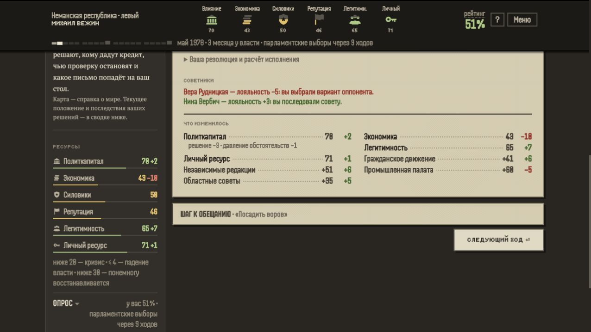
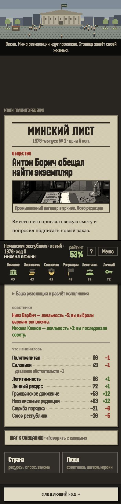

# Лояльность по показанному разговору — #170

GPT/Codex, 19 октября 2026. База main `b01c69a72f3f7165218e5645db83535f53f5d80a`, версия ветки 8.16.
Класс A: исправление состояния советников; до мёржа обязательно независимое ревью актуального SHA.

## Ошибка

В production 8.15 экономист предлагал выплатить зарплату и проверить договоры, но газета после подписи
снимала с него 5 лояльности за выбор оппонента и добавляла 3 политтехнологу. Авторский совет заменил
сгенерированный спор в интерфейсе, а последствия продолжали считать по скрытому сгенерированному спору.
Оттуда же в газету и счёт советников попадали количественные прогнозы, которых игрок не слышал.

## Изменение

Разговор и последствия берут один авторский обмен: первая реплика предлагает решение, вторая возражает,
третья отвечает. Предложивший выбранную резолюцию получает +3 лояльности, возражавший −5, в пределах
0–100. Остальные советники не меняются. Отсутствующий советник не создаётся и не получает запись.
Лояльность зависит от принятой позиции, а не от успеха исполнения. Не меняем величины бонуса/штрафа.

Авторские разговоры не содержат количественных прогнозов: для них не создаются сверка и записи
«верно/мимо». Нейтральный резервный разговор также не выдаётся за поддержку политики.
Генератор спора сохранён для обычного интерфейса и инструментов приёмки. Фиксированная сцена
приёмки 1978 использует зерно 5 вместо 1: после исправления лояльности прежний маршрут перестал
давать нужные противоположные позиции экономиста/силовика. Игровые начальные зёрна не меняются.

Сохранения не мигрируются; исправление применяется к следующим решениям. Варианты до/после открытия
совета дают одинаковые последствия. Изменённая лояльность может изменить дальнейшие утечки и саботаж:
это реальное влияние исправления, поэтому класс A. Отдельный баланс #96 не перенастраивается.

## Проверки

- `npm run check`: 368 тестов, типы и линтер — успешно.
- `npm run build`: успешно.
- Тесты сверяют все исторические варианты (3 зерна), все варианты пяти эпизодов расследования,
  успешное/проваленное исполнение, ограничения лояльности, отсутствие советника, неизвестный выбор,
  прямую подпись и подпись после совета/перезагрузки. Счёт прогнозов не увеличивается.
- [Сравнение с main](review-assets/advisor-feedback-170/compatibility.json): 112 партий, 1736 решений;
  шесть архивных стран и «Дело дня» 1978, четыре сложности × четыре зерна. SHA-256 всех полных
  состояний после решений совпали. Схема сохранения не менялась.
- [Мобильный прогон](review-assets/advisor-feedback-170/summary.json): партия закончилась после 13 решений,
  4648 мс до первого решения, `problems: []`, стол на первом ходу скрыт. Это техническая проверка,
  не замер интереса/удержания; длина случайной партии не сравнивается с другой партией.
- Ручная production-проверка: первое дело → совет → полный разговор → выплата/аудит → газета.
  Экономист Нина Вербич получила +3, возражавший политтехнолог Вера Рудницкая −5. Ведомость раскрыта:
  непрозвучавших прогнозов нет. Затем расследование → предложение силовика → результат:
  Михаил Кленов +3, возражавшая Нина Вербич −5. Следующее действие доступно. Error/warn пуст.
- Мобильный результат расследования проверен на 400×860. UI и ассеты не изменялись; PR #169 независим.

