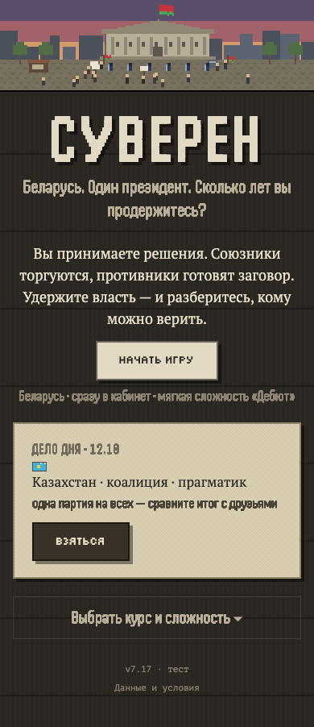

# Фокус мягкого запуска — Беларусь (#109)

12 октября 2026 · GPT/Codex · ветка codex/belarus-soft-launch от main 3a61e09.
Решение Кирилла: сначала одна цельная кампания Беларуси. Остальные страны остаются в данных и сохранениях.

## Поведение

- Обычные новые партии за Беларусь: быстрый старт новых/вернувшихся игроков и ручная анкета.
  На титуле страна видна до нажатия. В анкете выбираются только сложность, курс и необязательная биография.
- У новых игроков быстрый старт с «Дебютом», у вернувшихся с «Коалицией», как раньше; случайный курс сохранён.
- Продолжение старой партии не проходит через ограничение нового старта. Сохранение не мигрирует в Беларусь.
- «Дело дня» остаётся отдельным общим соревновательным сценарием, включая другие страны.
  Его страна видна в карточке; параметры и серверный расчёт прежние. Ограничение сейчас касается обычной кампании.
- Архив, достижения и данные шести стран сохранены. Параметры ref/channel не выбирают страну обычного старта.
- Тестовый вход для плейтеста теперь тоже создаёт Беларусь; фиксированное зерно 11 и исключение тестеров сохранены.

## Авторская проверка

Check: 286/286, lint и типы проходят; build проходит. Новый модуль с тестами проверяет обычный старт,
неизменность общего дела дня за 31 дату и продолжение/повторную загрузку сохранений всех стран.

Браузер собранной версии:
- Новый игрок и игрок с прежним архивом: быстрый старт → Беларусь, соответствующая сложность.
- Ручная анкета: нет кнопок выбора стран; курс/сложность → подача документов → вступление за Беларусь.
- Каждое из шести сохранений: продолжить → решение → подпись → reload; страна и ход сохранены.
- Дело дня 12 октября: Казахстан; страна, сложность, курс и преобразованное движком зерно совпадают
  с общим сценарием. Обычная политика старта его не переназначает.
- Ссылка с ref/channel: обычная новая партия за Беларусь.
- Анкета на 320/390/768/1280 без горизонтального переполнения. Ошибок JavaScript нет.

Проектный playtest с пределом 24 хода: развязка на ходу 15, problems: [], стола на первом ходу нет.
Автоматическое время до решения 4884 мс — характеристика скрипта, не измерение живого игрока.
Телефонные кадры ходов 1–3 и итогов проверены визуально; CI прикладывает свой прогон к PR.

Перенос разговорного спора в основную игру и первый срок как рубеж не входят в эту часть.
Разговор находится в PR #108, переход первого/второго срока — #110. Версия движка и выпуск не менялись;
перед новым замером состав выпуска и версия фиксируются отдельно. Независимое ревью новой части ожидается.
