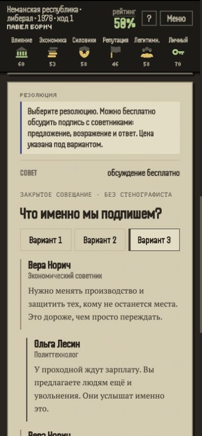
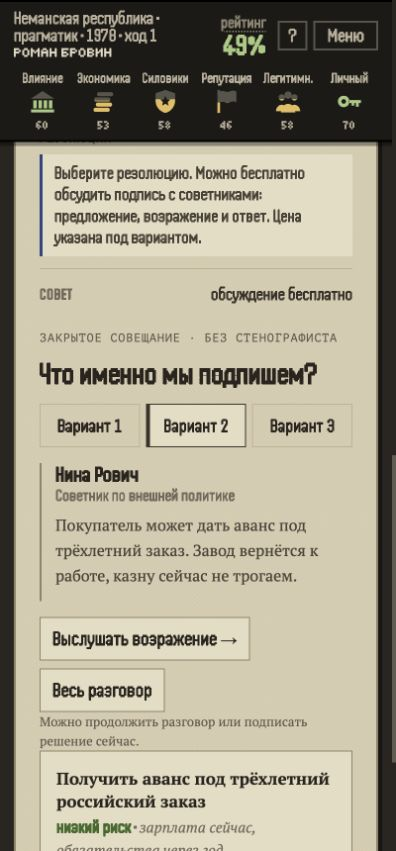

# Читаемость совета и стандартный документ демо — #168

GPT/Codex, 19 октября 2026. База main `b01c69a72f3f7165218e5645db83535f53f5d80a`, версия 8.15.
Тип: исправление ошибки интерфейса, класс B. Движок, сохранения, цены, реплики и графика не меняются.

## Причина и исправление

В автономном демо отсутствовали doctype и charset. Браузер подтвердил BackCompat и windows-1252.
Минифицированные CSS Modules дали классы `.e` и `.E`. В quirks mode они совпадали: стили точки-индикатора
задавали блоку тем совета ширину и высоту 5 px. Его кнопки выходили за границы и накладывались на реплики.

Демо теперь является полноценным русскоязычным UTF-8 HTML-документом в standards mode.
Полные названия тем остались в доступных именах кнопок; видимые подписи сокращены до «Вариант 1/2/3».
Переключатели сгруппированы и переносятся на узком экране. Выбранная карточка подписи сохраняет полный текст.

Штатный плейтест раньше сам оборачивал демо в standards-документ и скрывал этот дефект артефакта.
Теперь он открывает настоящий документ и проверяет режим, кодировку и границы переключателей совета.

## Загрузка шрифтов

Первый полный прогон после появления настоящего head не прошёл прежний лимит 15 секунд: 19,6 секунды
до решения. Отдельная диагностическая копия скрипта показала 10,6 секунды на навигацию, 11,6 до снимка
титула и 12,7 до открытия дела. Причина — ожидание внешней таблицы Google Fonts до исполнения страницы.

Стили внешних шрифтов сохранены, но загружаются без блокировки первого отображения и скрипта.
Навигация плейтеста ждёт DOMContentLoaded; готовность игрового пути проверяется реальными кнопками.
Порог первого решения не изменён. Первоначальный провал не считается успешной проверкой.

## Проверка браузером

- Демо и локальная production-сборка проверены на 320, 390, 400 и 1280 px.
- Везде CSS1Compat и UTF-8; нет горизонтального переполнения. Кнопки не выходят за блок тем,
  первая реплика начинается после него; высота каждой кнопки не меньше 44 px.
- В демо переключены все три темы: текущий ход и ресурсы сохранились, карточка подписи соответствует теме.
- Проверены поэтапное возражение и «Весь разговор». В production подписан недочитанный вариант;
  результат появился, главная кнопка — «Следующий ход»; журнал error/warn пуст.
- В новом узком DOM нет дополнительных блоков первого хода. Production-проверка локальная;
  доступ к удалённому Vercel preview этим не подтверждён.

Геометрия: [демо](review-assets/council-layout-168/demo-geometry.json),
[production](review-assets/council-layout-168/production-geometry.json).

## Скриншоты

До исправления, обычное окно 400 px:

После исправления, демо 400 px:

Production-сборка, 400 px:

## Итог проверок

- `npm run check`: 367 тестов, типы и линтер — успешно.
- `npm run build`: production-сборка — успешно.
- `npm run playtest -- --turns=24`: партия завершилась после 23 решений; первое решение 4100 мс,
  `problems: []`, стол на первом ходу скрыт, CSS1Compat / UTF-8.
- Порог 15 секунд сохранён. [Итог прогона](review-assets/council-layout-168/summary.json).
