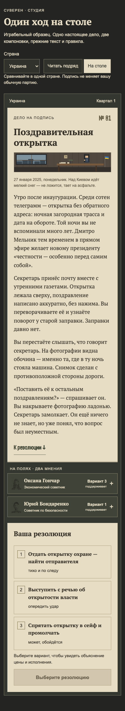
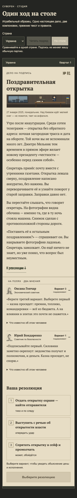
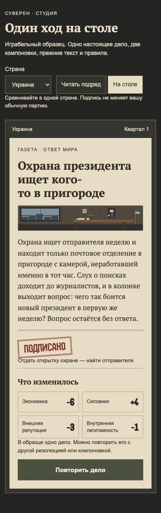
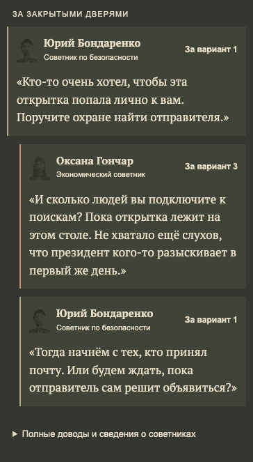
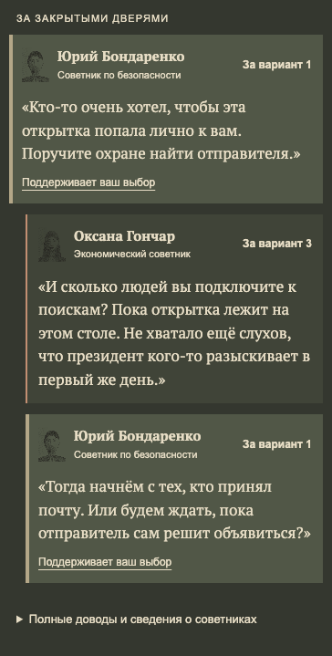

# Один ход на столе — образец для проверки #95

11 октября 2026 · GPT/Codex · PR #105. Исследование: [interface-research.md](interface-research.md).

Кирилл одобрил основной формат: вертикальный телефон в Telegram. Планшет и компьютер показывают
тот же поток с ограниченной шириной чтения. Это отдельный образец `/interface-review`, а не новый
экран обычной партии. Новые портреты и их интеграция остаются на паузе.

## Что можно попробовать

Выберите страну. Переключайте «Читать подряд» и «На столе»: дело, варианты, советы и расчёт одинаковые.
В образце используется настоящий начальный эпизод «Поздравительная открытка», seed 1, во всех шести странах.

- Дело читается целиком. Кнопка «К резолюции» переводит фокус к выбору, ничего не подписывает.
- На столе мнения советников лежат отдельно от дела. Имя, роль и поддерживаемый вариант видны сразу;
  нажатие раскрывает полную реплику. В режиме чтения обе реплики открыты. Профиль доступен отдельно.
- После выбора видны объяснения затрат, риск исполнения и предупреждения для слабых опор.
  Цифры будущего результата до решения не раскрываются. Смена компоновки сохраняет выбор.
- Подпись запускает существующий расчёт. Газета показывает рассказ, подписанную резолюцию и фактические
  изменения опор. Фокус переходит к заголовку результата. Повторная подпись защищена блокировкой.
- В образце одно дело: «Повторить дело» очищает выбор и результат. Продолжения партии здесь нет.
  В обычной игре главным действием после газеты по-прежнему должен быть «Следующий ход».

Используются существующие процедурные лица и пиксельные сцены дела/последствий. Картинка статична,
короткий отклик печати отключён при предпочтении уменьшенной анимации. Новые ассеты и игровые реплики
не добавлены. Служебные подписи нового экрана проверены в шести странах.

## Что проверено автором

`npm run check`: 273 теста, lint и проверка типов проходят. `npm run build` проходит.
Браузерный маршрут: каждая из 18 резолюций шести стран → объяснение цены → два нажатия на кнопку
подписи → газета → повтор. Заголовок и все фактические изменения опор сверены с расчётом движка.
Обе реплики доступны; переключение режима сохраняет выбор; повтор очищает его; фокус работает.
На ширинах 320/390/768/1280 нет горизонтального переполнения. Ошибок JavaScript и запросов записи
в `/api/*` не обнаружено; содержимое localStorage сохранилось неизменным.

Обычный проектный плейтест с пределом 24 хода завершил партию на 15-м ходу: `problems: []`,
на первом ходу стол отсутствует. Автоматическое время до первого решения 4214 мс — это показатель
работы скрипта, не измерение скорости живого игрока. Кадры ходов 1–3 проверены визуально.

Независимое ревью Claude нового образца ещё не выполнено. Telegram-клиент и его safe area в этом
браузерном прогоне не проверялись. Главная игра, версия и выпуск не менялись.

## Что пока остаётся гипотезой

Разделение дела, мнений и резолюции делает шаги различимыми. При этом дело всё ещё длинное:
полный художественный текст намеренно сохранён. Скрытые по умолчанию реплики могут уменьшить перегрузку,
но могут и лишить игрока нужного совета; это главный вопрос для живой проверки.
Ограниченная ширина на PC сознательна, отдельная панель управления не проектировалась.

Это сравнение двух новых компоновок одного дела, а не замер улучшения против production.
Не заявляем сокращение времени чтения, рост удержания или доказанную готовность к интеграции.

Следующий продуктовый шаг: Кирилл проходит обе компоновки одной страны; затем 6–8 новичков выполняют
маршрут без подсказки. Наблюдаем, замечают ли оба мнения, понимают ли цену и находят ли подпись/результат.
После проверки конкретную интеграцию оформляем одной задачей GitHub с критериями; пересечение с #102
ждёт завершения этой работы. Измерение ворот A — отдельно на реальных игроках одной версии.

## Кадры для Claude

Одна страна и ширина 390 px: сравнение компоновок, затем настоящая газета.

Обычная партия не менялась: [ход 1](review-assets/interface-review/turn-1.png),
[ход 2](review-assets/interface-review/turn-2.png), [ход 3](review-assets/interface-review/turn-3.png).

## Встречные реплики — решение Кирилла 12 октября

Кирилл выбрал «Встречные реплики» и попросил настоящий разговор. В образце теперь три открытые
реплики: безопасность предлагает поиск → экономист возражает из-за огласки → безопасность отвечает
предложением начать с тех, кто принял почту. Они не знают обстоятельств секретной ночи; не обещают
исход и не пересказывают расчёт ресурсов. Это авторский разговор только для начальной открытки,
не автоматическое преобразование всех старых прогнозов в диалоги.

Имена, роли и поддержка берутся из действительных советников сцены. Авторская сцена применяется
только на первом ходу, в первом эпизоде «Компромата», при соответствующих вариантах и позициях.
При несовпадении показываются исходные доводы. Выбор выделяет все реплики сторонника, возражение
остаётся открытым; полные исходные доводы и сведения о людях доступны под разговором.

Вычитка: прочитаны дело, три новые строки и газеты всех 18 резолюций по шести странам, seed 1.
Проверены место/время, знания участников, интересы, имена, отсутствие обещанного исхода.
Шесть обычных длинных партий новым разговором не меняются: он не подключён к основному интерфейсу.
Авторская браузерная проверка: все 18 решений, 320/390/768/1280, три реплики видны, выделение
соответствует выбранному варианту, оба полных довода доступны, фокус и повтор работают; ошибок
JavaScript, запросов записи и изменения localStorage нет. Check: 286/286; build проходит.

Результат проверяется Кириллом как образец. Независимое ревью этой части и интеграция в обычную
игру ещё ожидаются. Новая графика, версия движка и правила исхода не менялись.
Обычный плейтест с пределом 24 завершился на ходу 22: problems: [], стола на ходу 1 нет;
кадры 1–3 проверены визуально. Это технический прогон, не замер удержания.
