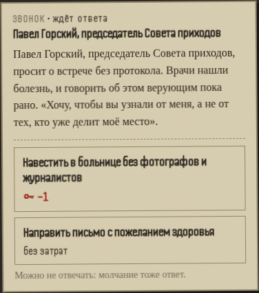
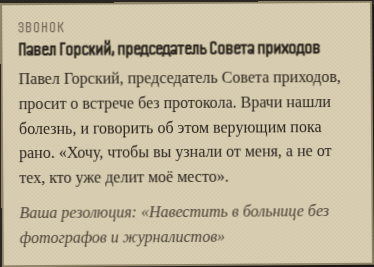
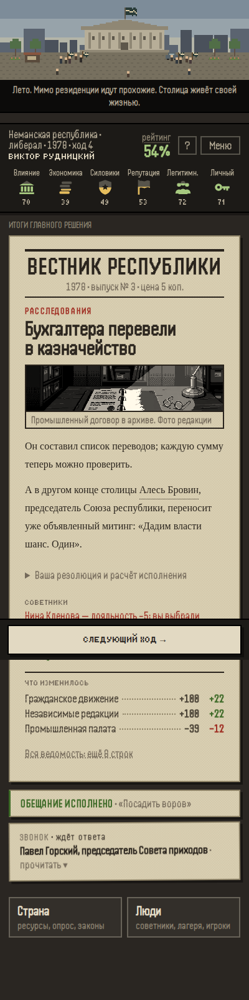

# Ответы на личные письма — #156

Claude/Opus, 19 октября 2026. Дизайн — Gemini, «Резолюции на полях». База `main` `c0183c3`, версия 8.18.

## Что видит игрок

- Под письмом одной из историй людей появляются две резолюции: личное участие и аппаратная дистанция.
  Цена каждой видна до выбора.
- Свёрнутое письмо помечено «ждёт ответа». Ответ необязателен: молчание оставляет историю по отношению героя, как раньше.
- Главная кнопка после хода — «Следующий ход».
- Ответ определяет продолжение истории и её развязку: тёплый финал или холодный, своя записка, свой итог.

## Истории кампании 1978 года

В кампании встречаются семь историй; история про отопление в 1978 году не встречается — нет подходящего героя.

| История | Письмо с ответом | Личное участие | Дистанция |
| --- | --- | --- | --- |
| retire | 1-е | чай без стенографиста: личный ресурс −1 | кадровый резерв: политкапитал +1 |
| hometown | 1-е | проверить снабжение: личный ресурс −1 | кивнуть: без затрат |
| illness | 1-е | навестить без фотографов: личный ресурс −1 | письмо с пожеланием: без затрат |
| wedding | 1-е | заехать с цветами: личный ресурс −1 | подарок через комендатуру: без затрат |
| book | 1-е | интервью без согласования: личный ресурс −1, легитимность +2 | отказ: политкапитал +1 |
| son | 1-е | не печатать снимки: легитимность −3, отношение +15 | суд: легитимность +2, отношение −15 |
| farewell | 2-е, приглашение | прощальный ужин: личный ресурс −1, репутация +2 | протокольный приём: без затрат |

## Скриншоты, 400 px

