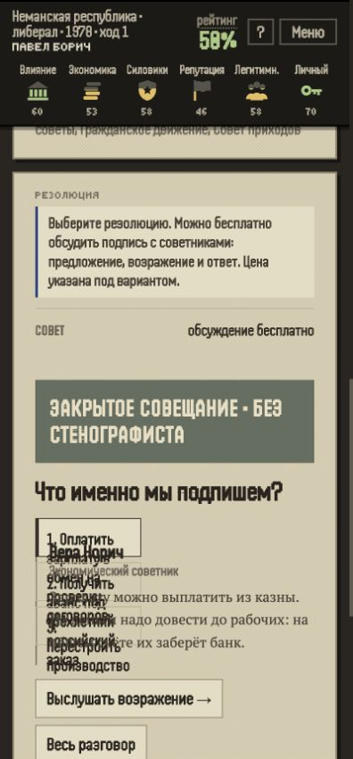

# Синтетический игрок: первый срок «Суверена», 19 октября 2026

Автор: GPT/Codex. Прямое поручение Кирилла: пройти игру в роли платёжеспособного любителя жанра.

## Вывод

У партии есть собственная история, которую можно пересказать: попытка спасти рабочих, проверка заводских договоров,
открытые закупки, освобождённый корреспондент и районные врачи. В выбранной роли первый срок захотелось закончить.
На второй срок есть конкретный мотив: сохранить врачей и проверить исполнение их финансирования.

Два особенно заметных препятствия: нечитаемая вёрстка выбора темы совета на телефоне и несовпадение участников
разговора с сообщениями об изменении их лояльности. Они мешают основной идее игры — понимать людей и доверять
наблюдаемой связи между подписью и результатом.

Это одна синтетическая сессия. Желание продолжить и платить — интерпретация заданной роли, не замер спроса,
покупки или удержания настоящих игроков. Численные оценки вероятности покупки не выставлялись.

## Условия и границы

- Свежая `main`: `b01c69a72f3f7165218e5645db83535f53f5d80a`, версия 8.15, после мёржа #165–167.
- Локальное автономное демо, собранное из этой main. Публичная выкладка и Telegram не проверялись.
- Основной checkout с незакоммиченной работой Gemini не менялся для запуска; игра собрана в отдельной копии.
- Браузерное прохождение вручную через интерфейс, 400 × 860. 20 главных решений, итог первого срока на ходу 21.
- Обычная новая партия кнопкой «Начать игру», стартовая сложность «Дебют». Президент Роман Острин, прагматик.
- Зерно не извлекалось из скрытого состояния; использовались только сведения интерфейса.
- Во время принятия решений исходники, формулы и будущие события не читались. Автовыбор вариантов не применялся.
- Чистое время до первого решения не замерено: задержки инструментов и чтения нельзя выдавать за время человека.
- В конце основного прохождения журнал браузера не содержал захваченных сообщений уровня error/warn.
- Объективные дефекты отделены ниже от предположений об интересе. Исправления в рамках этой проверки не вносились.

## Роль

Условный Алексей, 33 года, русскоязычный работающий взрослый. Покупал одиночные игры, интересуется историей,
общественными институтами и стратегиями. Деньги на игры есть, свободное внимание ограничено.
Возраст и биография задают тестовый контекст, а не описывают измеренный средний возраст аудитории.

Основная мотивация — политическая история с возможностью провести собственный курс и увидеть последствия.
Намерение партии: поднять промышленность, сохранить доверие людей, не покупать послушание чиновников.
Склонности: проверять документы, защищать свидетелей, выбирать компетентных исполнителей, избегать лишних долгов.
Поражение приемлемо, если понятны его причины. Непоследовательность объяснений снижает доверие к игре.

## Пройденный маршрут

| Ход | Решение | Мотив и наблюдение |
| --- | --- | --- |
| 1 | Зарплата рабочим с проверкой договоров | Выслушал завод и совет. Деньги забрал банк; в расчёте показана вероятность успеха 83%. |
| 2 | Сверить договор с банковским архивом | Независимая копия вместо доверия директору. Банк выдал приложение. |
| 3 | Защитить бухгалтера и проверить переводы | Свидетеля перевели в казначейство, появился проверяемый список переводов. |
| 4 | Прямые договоры хозяйств с пекарнями | Убрать посредника; принял риск неравных цен. |
| 5 | Утеплить жилые кварталы | Меньше зависимости от поставщика топлива. Смены на заводах сократились. |
| 6 | Разговор министра с работницей в эфире | Министр не ответил на неудобный вопрос; игра назвала это провалом. |
| 7 | Изъять журнал выдачи и проверить подписи | Сохранить оригинал; продолжить начатую проверку. |
| 8 | Бюджет: 1/2/4/1/2, без займа | Сократил армию и аппарат ради дорог и инвестиций. |
| 9 | Пресс-конференция | Доказательства до обвинений, собственный внешний курс, открытая декларация. |
| 10 | Единый график железной дороги | Исправить борьбу министерских приказов. Партия выиграла парламентские выборы с 55%. |
| 11 | Проверка задержания с участием редакции | Представитель редакции, открытый протокол и копия семье. |
| 12 | Прокурорское дело без остановки производства | Исполнение сорвалось: арестованы оба счёта. Отдельно пришёл протокол освобождения корреспондента. |
| 13 | Деньги на ремонт районному совету | Не доверять областному отчёту о несуществующем ремонте. Врач участвовал в приёмке. |
| 14 | Закон об открытых областных заказах | Закрепить прозрачность. Сметы и владельцы фирм попали в публичный бюллетень. |
| 15 | Испытательная линия насосного завода | Пробный выход на новый рынок; первый заказ получен. |
| 16 | Сохранить бумаги, опубликовать сумму гарантии | Не закрывать переписку после неудачной проверки. Получилась проверка будущих гарантий. |
| 17 | Принципы и договорённость о марше | Условия конкретного марша остались неясными. |
| 18 | Выборы на общих основаниях | Продолжить начатое с мандатом избирателей. |
| 19 | Последняя пресс-конференция | Работать до последнего дня; обсуждать пенсии до обещаний; готовить кадровые решения. |
| 20 | Взыскать долг с владельцев заводов | Суд вернул требование государству: заводы приобретены без старого долга. |

Между делами:

- Назначил инженера Романа Кленова: компетенция 3/3 важнее личной близости.
- Поддержал инженера личной поездкой, затем сменил поставщика оборудования. Энергосеть завершилась на 80%.
- Назначил главврача Виктора Ярового и согласовал его полномочия. Районные больницы укомплектованы на 100%.
- Перед выборами закрепил врачам зарплаты и жильё на следующий год. Итог исполнения ожидается на втором сроке.

Итог: переизбрание 62% против 14%, пять лет у власти. Одно обещание выполнено, два нарушены.
Экономика 39, влияние 23, силовики 32, репутация 68, легитимность 89, личный ресурс 20.
Силовой лагерь −69; предупреждение о риске переворота. Победа на выборах не сняла накопленную угрозу.

## Что удерживало в партии — интерпретация роли

1. Первое утро быстро даёт человека, проблему и ответственность. Звонок рабочих добавляет смысл первому выбору.
2. Конкретный совет полезен: предупреждение о банковском списании меняет понимание выплаты зарплаты.
3. Переговоры с редактором заметно сильнее общего выбора тона. Условие включено в поручение, потом пришёл протокол:
   основания задержания не подтвердились, корреспондента освободили, копию получила семья.
4. Программы допускают намерение и коррекцию курса. Понятно, зачем инженеру политическая защита и другое оборудование.
5. Больницы имеют человеческий результат: специалисты принимают рядом с домом. Затем появляются расходы на сохранение
   ставок — возникает причина продолжить управление, а не только увеличить процент готовности.
6. Итог выборов вспоминает завод, вопрос работницы, испытательную линию, закон и обещания. Это узнаваемая память партии.

## Подтверждённые наблюдения

### 1. Варианты разговора совета накладываются на первую реплику

На 400 × 860 темы «1. Оплатить…», «2. Получить…», «3. Перестроить…» занимают узкий блок и перекрывают друг друга,
имя советника и начало его реплики. Текст нельзя нормально прочитать глазами, хотя дерево доступности его содержит.

Проверка повторена на чистом запуске в другом локальном origin, с другим президентом и именами советников.
Дефект виден на обычном скриншоте окна; это не только эффект длинного снимка страницы.

Воспроизведение: новая партия → первое дело → «Обсудить подпись», ширина 400 px.

### 2. Итоги лояльности противоречат показанному разговору

Ход 1: Нина Вежин предлагает выплату с проверкой договоров; Вера Рович возражает.
Выбрана выплата с проверкой. Итог: Вера +3 «вы последовали совету», Нина −5 «вы выбрали вариант оппонента».

Ход 4: прямые договоры предлагает Нина, Вера возражает. Итог сообщает про Ольгу Бровин +3 и Леонида Лугового −5,
которые в показанном разговоре этого варианта не участвовали.

Это наблюдаемое несоответствие. Правильность внутренних чисел отдельно не проверялась; причина в коде не установлена.

### 3. Часть служебных надписей содержит испорченные символы

На кнопках раскрытия видны `â–¾`; заголовки личных писем содержат нечитаемый хвост вместо «прочитать».
Это видно на скриншотах, не только в дереве доступности. Проверено в локальном демо; наличие на production не установлено.

## Впечатления, требующие обсуждения и проверки на людях

- **Личные письма вызывают желание действовать.** Министр просит не отдавать ведомство ожидающему преемнику;
  председатель приходов просит о встрече из-за болезни. Ответить или задать вопрос нельзя. Это согласуется с #156.
- **Поздний звонок слабее предметного разговора с редактором.** На ходу 17 показаны «идеалист» и подсказка выбрать
  подход по характеру. После «часть требований — ваша уступка» непонятны разрешение марша, маршрут и обязательства.
- **Повторяются объяснения цены.** В нескольких эпизодах расследования это «бизнес затаился и выводит деньги» и
  «вы наживаете влиятельных врагов». После нескольких повторений в выбранной роли их начинаешь пропускать.
- **Пять эпизодов не дают ожидаемого закрытия заводского дела.** После сбора приложения, переводов и журнала
  неудача прокурора оставляет только публикацию суммы и проверку будущих гарантий. На ходу 20 тот же договор 1956 года
  и его приложение снова представлены как находка депутата. Нужна редакторская сверка связи двух сюжетов, а не вывод
  о неправильной переменной без исследования кода.
- **Отложенные последствия слабо объяснены.** У решения об утеплении появились и «Экономия оздоровила бюджет»,
  и «Раздача денег разогнала цены». Совместимость эффектов возможна, но на экране не объяснена конкретным действием.
- **Штамп «ПРОВАЛ» бывает спорным с точки зрения моего курса.** Работница задала министру неудобный вопрос в эфире.
  Для роли, которая хочет открытого разговора, это содержательный результат, хотя министр не справился.
- **Некоторые условия угадываются по меткам.** «Идеалист → принципы», «честно» и стрелки сокращают пространство
  размышления. Во второй пресс-конференции сознательно выбрано обсуждение пенсий, хотя интерфейс обещал потерю.

## Смоделированное решение о продолжении и покупке

В роли этого игрока я закончил бы первый срок и захотел проверить сохранение врачей на втором.
Обещание платного продолжения должно содержать новые конкретные конфликты вокруг построенного мной государства,
память персонажей и возможности довести начатое. Одна прибавка сложности и новые общие карточки слабее такого обещания.

Сейчас желание купить продолжение остаётся условным: сначала нужна читаемость совета, согласованная обратная связь
о людях и уверенность, что продолжение развивает историю первого срока. Ценовой порог по этой партии не определён.

## Артефакты

- [Журнал экранов и решений с хода 4](review-assets/persona-2026-10-19/journal.json).
- Ходы 1–3 и результаты: `review-assets/persona-2026-10-19/turn-1.png` … `turn-3-result.png`.
- [Согласованная проверка с редактором](review-assets/persona-2026-10-19/turn-11-negotiation.png).
- [Больницы укомплектованы](review-assets/persona-2026-10-19/hospitals-complete.png).
- [Последнее решение о договоре](review-assets/persona-2026-10-19/turn-20-decision.png).
- [Полный итог срока](review-assets/persona-2026-10-19/end-full.png).
- [Итог выборов в обычном окне](review-assets/persona-2026-10-19/election-result.png).

Отчёт и снимки сохранены локально; сами по себе они не опубликованы в GitHub. Производительность и удержание
настоящих игроков этой сессией не измерялись.
